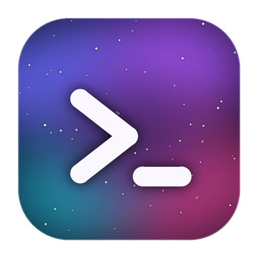

<p align="center">
  
</p>

<h1 align="center">NebulaCodex</h1>

<p align="center">
  Agente de código <b>libre</b> para la terminal. Lee, busca y edita tus archivos y ejecuta comandos<br>
  con el modelo que vos elijas: Anthropic, OpenAI, Gemini, Groq, NVIDIA, OpenRouter, Ollama y más.
</p>

<p align="center">
  <a href="https://github.com/Tpskevin13/nebulacodex/actions/workflows/ci.yml"></a>
  <a href="https://github.com/Tpskevin13/nebulacodex/releases/latest"></a>
  <a href="LICENSE"></a>
</p>

---

## Qué es

NebulaCodex es una aplicación de terminal (TypeScript + [Ink](https://github.com/vadimdemedes/ink)) que funciona como un asistente de programación con herramientas:
le pedís algo en lenguaje natural y el agente puede **listar, leer, buscar, crear, editar, mover y borrar archivos**, **ejecutar comandos** y **consultar páginas web**.
Todo lo que modifica algo te pide permiso antes de ejecutarse.

- **27 proveedores** de IA incluidos, más cualquier endpoint compatible con OpenAI ([lista completa](docs/PROVIDERS.md)). Tu clave, tu modelo, sin intermediarios.
- **Enrutamiento por tarea:** podés usar un modelo para código, otro para razonamiento y otro para chat (`/route`).
- **Todo se configura dentro de la app** (`/providers`): no hay archivos que editar a mano.
- **Chats guardados**, exportación a Markdown y deshacer los últimos cambios del agente (`/undo`).
- **Interfaz cuidada:** pantalla alternativa que no ensucia tu terminal, Markdown renderizado, pegado de textos largos.

## Descargar e instalar

Bajá el instalador de tu sistema desde la página de **[Releases](https://github.com/Tpskevin13/nebulacodex/releases/latest)**.
**No hace falta tener Node.js**: cada instalador trae el suyo.

| Sistema | Archivo | Qué hace |
| --- | --- | --- |
| **Windows 10/11** | `NebulaCodex-<versión>-windows-x64-setup.exe` | Asistente de instalación: acceso directo en el escritorio y en el menú Inicio, comando `nebulacodex` opcional y desinstalador en *Aplicaciones instaladas*. Sin permisos de administrador. |
| Windows (portátil) | `NebulaCodex-<versión>-windows-x64-portable.zip` | Descomprimí y abrí `NebulaCodex.cmd`. No instala nada. |
| **macOS 13.5+** | `NebulaCodex-<versión>-macos.dmg` | Abrí el disco y hacé doble clic en **Instalar NebulaCodex.command**: copia la app a *Aplicaciones*, crea el acceso directo en el escritorio y el comando `nebulacodex`. Apple Silicon e Intel. |
| **Linux x86_64** | `NebulaCodex-<versión>-linux-x64.sh` | `sh NebulaCodex-<versión>-linux-x64.sh` instala para tu usuario (sin `sudo`): menú de aplicaciones, escritorio y comando `nebulacodex`. |
| **Linux ARM64** | `NebulaCodex-<versión>-linux-arm64.sh` | Igual que el anterior, para equipos ARM. |

Linux con `sudo sh <archivo> --system` instala para todos los usuarios. `sh <archivo> --help` muestra todas las opciones.

### Si el sistema muestra una advertencia

Los instaladores **no están firmados** con certificados de pago (cuestan cientos de dólares por año), por eso:

- **Windows (SmartScreen):** *Más información* → *Ejecutar de todas formas*.
- **macOS (Gatekeeper):** clic derecho sobre el archivo → *Abrir* → *Abrir*. Si sigue bloqueado:
  `xattr -dr com.apple.quarantine /Applications/NebulaCodex.app`
- Podés verificar la descarga con `SHA256SUMS.txt`, que está en cada Release.

Cada instalador se prueba automáticamente en Windows, macOS y Linux reales antes de publicarse (instala, abre la app y desinstala).

### Desinstalar

- **Windows:** *Configuración → Aplicaciones → NebulaCodex → Desinstalar*.
- **macOS:** `Desinstalar NebulaCodex.command` (está en el mismo disco).
- **Linux:** `sh ~/.local/share/nebulacodex/uninstall.sh` (con `sudo sh /opt/nebulacodex/uninstall.sh` si instalaste con `--system`).

Tu configuración y tus chats (`~/.nebulacodex`) se conservan; los desinstaladores te preguntan o aceptan `--purge` para borrarlos.

## Primer uso

1. Abrí **NebulaCodex** desde el escritorio, el menú de aplicaciones o escribiendo `nebulacodex` en una terminal. Se abre en la carpeta actual.
2. La primera vez aparece la pantalla **Proveedores de IA**: elegí uno, pegá tu API key y listo. (Ollama y los endpoints locales no necesitan clave).
3. Escribí lo que necesitás. `/` muestra los comandos.

También podés usar una variable de entorno en lugar de guardar la clave (por ejemplo `GROQ_API_KEY`); mirá la [tabla de proveedores](docs/PROVIDERS.md).

### Comandos

| Comando | Qué hace |
| --- | --- |
| `/providers` | Cambiar proveedor, API key y modelo |
| `/model` | Elegir otro modelo de la lista del proveedor |
| `/settings` | Ajustes de NebulaCodex |
| `/effort <bajo\|medio\|alto\|maximo>` | Esfuerzo de razonamiento |
| `/route [on\|off\|set\|clear\|principal]` | Enrutamiento por tarea |
| `/status`, `/pwd`, `/cd <ruta>` | Proveedor activo y carpeta de trabajo |
| `/files`, `/find <texto>`, `/search <texto>` | Explorar y buscar en la carpeta |
| `/chats`, `/chat [búsqueda]`, `/clear` | Conversaciones guardadas |
| `/tools` | Herramientas del agente y sus permisos |
| `/undo` | Deshacer el último cambio de archivos del agente |
| `/export [nombre]` | Guardar el chat como Markdown |
| `/help`, `/exit` | Ayuda y salir |

`nebulacodex --version` y `nebulacodex --help` funcionan sin abrir la interfaz.

## Seguridad y datos

- **Permisos:** `write_file`, `edit_file`, `delete_file`, `move_file`, `run_command` y `fetch_url` piden aprobación antes de ejecutarse. No hay *sandbox*: lo que aprobás corre con tus permisos, así que revisá lo que pide.
- **`fetch_url`** bloquea `localhost`, redes privadas, metadatos de nube y redirecciones hacia ellos. Queda un riesgo residual de *DNS rebinding* documentado en [`docs/AUDIT.md`](docs/AUDIT.md).
- **Tus API keys** se guardan en `~/.nebulacodex/config.json` en texto plano, con permisos `0600` en Linux y macOS. Los chats, en `~/.nebulacodex/chats/`. NebulaCodex no tiene telemetría: sólo habla con el proveedor que elegiste.
- Para reportar una vulnerabilidad: [SECURITY.md](SECURITY.md).

## Modelos y enrutamiento

El clasificador de tareas es determinista (no gasta una llamada extra) y elige el modelo en este orden: **modelo de la tarea → modelo principal → proveedor activo**.
La evaluación de modelos, la metodología y las decisiones están en [`docs/MODELS.md`](docs/MODELS.md); el informe de pruebas, en [`docs/TEST-REPORT.md`](docs/TEST-REPORT.md); y la auditoría técnica, en [`docs/AUDIT.md`](docs/AUDIT.md).

> NebulaCodex no genera mallas 3D ni imágenes: el enrutamiento `three_d` cubre texto y código (especificaciones y módulos Three.js).

## Desde el código fuente

Requisitos: **Node.js 18 o superior** y npm.

```bash
git clone https://github.com/Tpskevin13/nebulacodex.git
cd nebulacodex
npm install
npm run build
npm start            # o: ./iniciar.sh (Linux/macOS) · .\iniciar.ps1 (Windows)
```

Desarrollo y calidad:

```bash
npm run dev          # ejecuta src/ directamente con tsx
npm test             # pruebas automatizadas (node:test + tsx)
npm run check:live   # llamadas reales a proveedores (necesita API keys)
npm run eval         # benchmark de modelos (necesita API keys)
```

Para generar los instaladores en tu máquina: `npm run build && npm run package -- --target linux-x64` (también `linux-arm64`, `macos` y `windows-x64`; cada uno hay que correrlo en su sistema, o en cualquiera para Linux). Mirá [CONTRIBUTING.md](CONTRIBUTING.md).

## Estructura

```text
src/            código de la aplicación (core/ = agente, herramientas y proveedores; ui/ = interfaz; app/ = pantalla principal)
test/           pruebas automatizadas
scripts/        evaluación de modelos, empaquetado (package.mjs) y utilidades de CI
installers/     fuentes de los instaladores de Windows, macOS y Linux
assets/         icono de la aplicación
docs/           auditoría, informe de pruebas, modelos y proveedores
windows-launcher/  lanzador .NET histórico (se conserva por compatibilidad; los instaladores nuevos no lo usan)
```

## Licencia

[MIT](LICENSE) © 2026 Tpskevin13.

NebulaCodex es un proyecto independiente y comunitario. Los nombres de los proveedores y modelos que aparecen son marcas de sus respectivos dueños;
este proyecto no está afiliado ni respaldado por ninguno de ellos.

---

<details>
<summary><b>English</b></summary>

**NebulaCodex** is a free, open-source coding agent for the terminal (TypeScript + Ink). It can read, search, edit and move files, run commands and fetch web pages,
using the LLM provider of your choice (27 presets + any OpenAI-compatible endpoint). Anything that changes your system asks for approval first.

**Install:** download the installer for your OS from the [latest release](https://github.com/Tpskevin13/nebulacodex/releases/latest) — Windows `.exe` (or portable `.zip`),
macOS `.dmg`, Linux `.sh`. They bundle their own Node.js, so nothing else is required. The installers are unsigned (Windows SmartScreen / macOS Gatekeeper may warn on first run).
Then open NebulaCodex and type `/providers` to choose a provider and paste your API key — all configuration happens inside the app.

**From source:** Node.js ≥ 18, then `npm install && npm run build && npm start`. Tests: `npm test`.

Licensed under the [MIT License](LICENSE). Not affiliated with any model provider.

</details>
